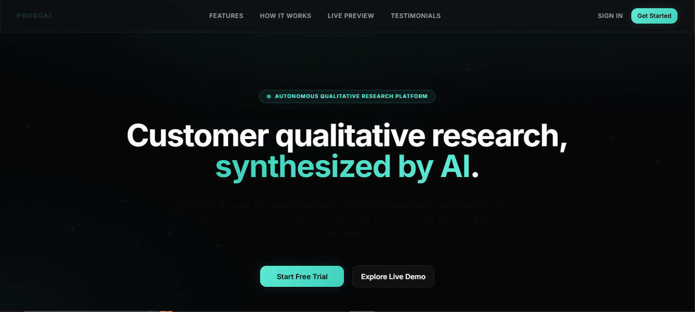
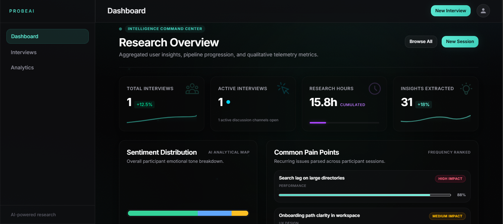
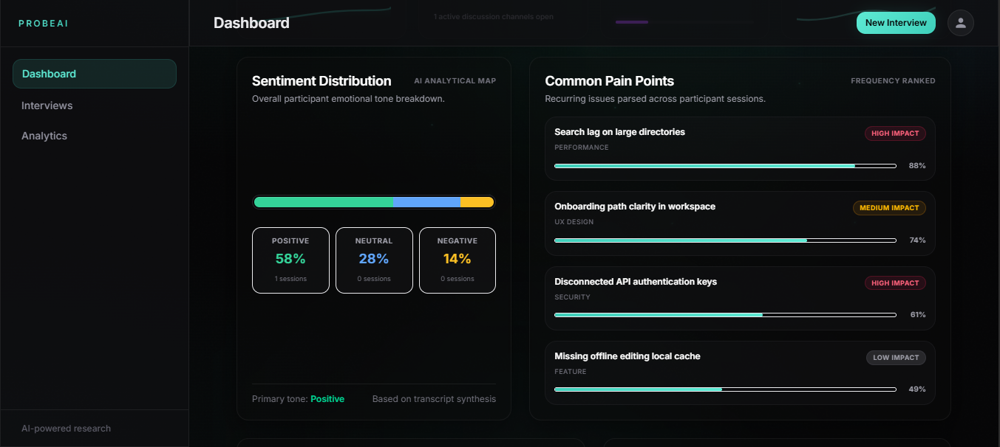
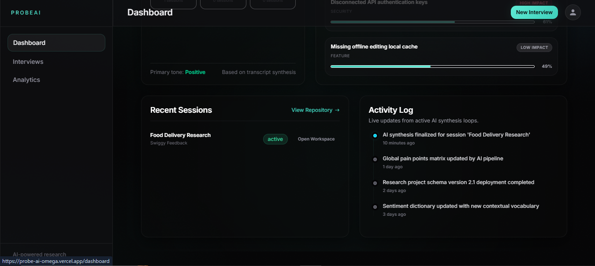
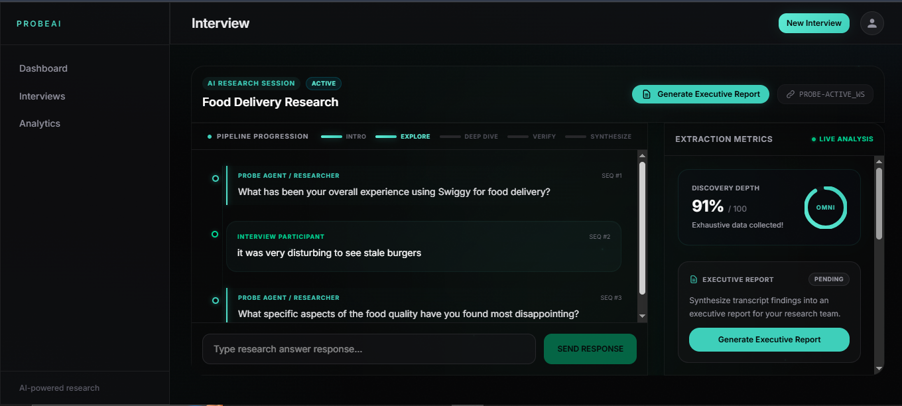
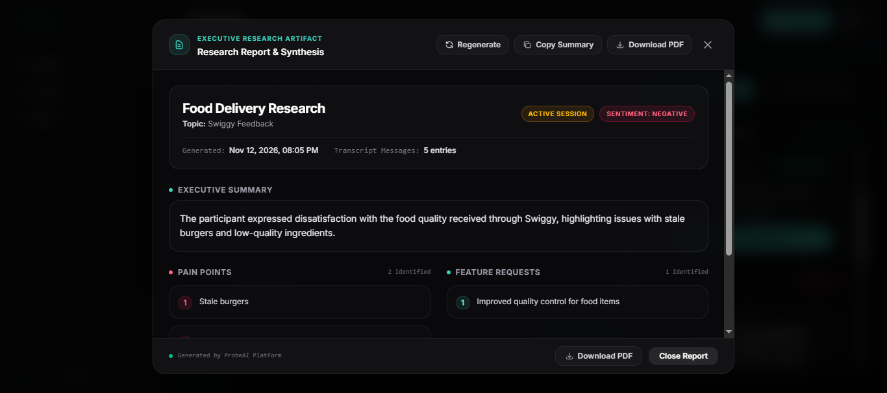
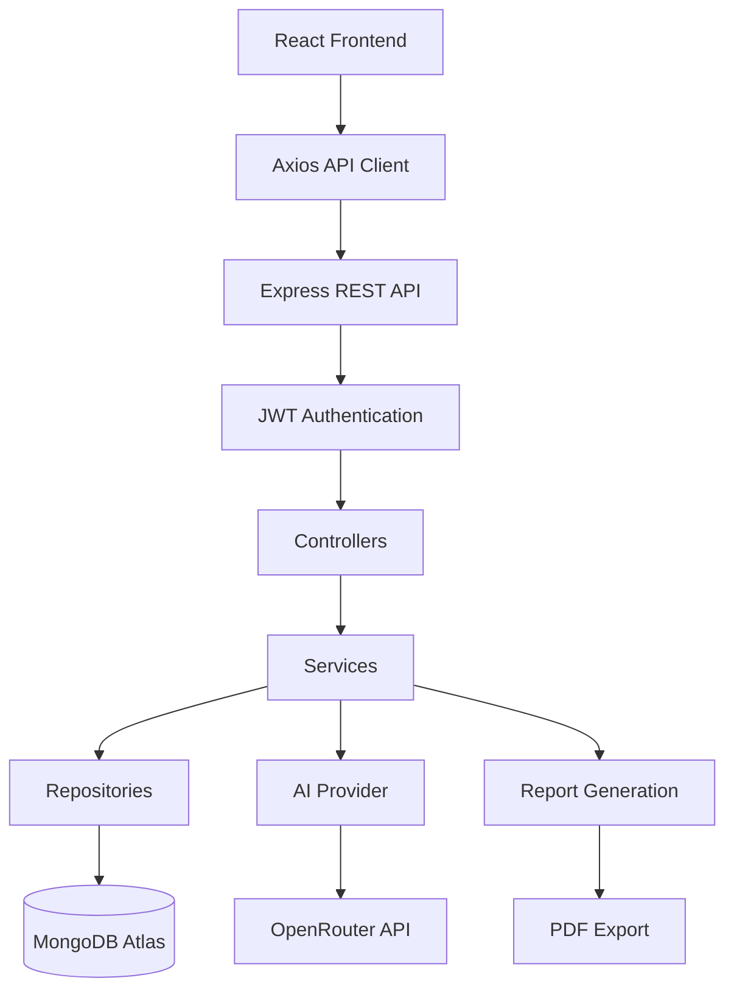

# ProbeAI — AI-Powered Customer Research Platform

**Turn customer conversations into structured business insights with AI.**

ProbeAI is an AI-powered customer research platform designed to help startups conduct structured customer interviews, understand user feedback, identify patterns, and generate actionable executive reports.

Instead of manually reviewing every conversation, ProbeAI uses an AI interviewer to conduct contextual interviews and transform responses into meaningful research insights.

<p align="center">
  <a href="https://probe-ai-omega.vercel.app/"><strong>Live Demo</strong></a>
  &nbsp; · &nbsp;
  <a href="https://github.com/Yashhh25/ProbeAI"><strong>Source Code</strong></a>
</p>

---

## Overview

Customer research is essential for building products people actually need. However, conducting interviews, analyzing responses, and preparing research reports can be time-consuming.

ProbeAI streamlines this workflow through AI-assisted interviews and automated reporting.

## Screenshots

### Landing Page



### Dashboard







### AI-Powered Interview



### Executive Report



## Key Features

- **Authentication:** Secure user registration and login with JWT-based authentication.
- **AI-Powered Interviews:** Conduct contextual customer interviews using an AI interviewer.
- **Dynamic Follow-up Questions:** Generate relevant follow-up questions based on previous responses.
- **Transcript Persistence:** Store interview conversations for later review.
- **Live Insights:** Generate research insights from interview responses.
- **Executive Reports:** Generate structured executive reports from completed interviews.
- **PDF Export:** Download generated reports as PDF documents.
- **Access Control:** Enforce interview ownership checks to prevent unauthorized access.

## Application Architecture

ProbeAI follows a layered backend architecture to separate HTTP handling, business logic, data access, and AI integration.



### Backend Request Flow

1. The frontend sends an HTTP request to the Express API.
2. Authentication middleware validates the JWT where required.
3. Controllers handle incoming requests and delegate business logic.
4. Services coordinate interview, messaging, insight, and report operations.
5. Repositories interact with MongoDB through Mongoose.
6. AI services communicate with OpenRouter to generate contextual responses and reports.
7. Results are returned to the frontend.

## Technology Stack

| Layer | Technologies |
|---|---|
| Frontend | React, Vite, React Router |
| State / Data Fetching | TanStack Query |
| Styling | Tailwind CSS, CSS |
| Backend | Node.js, Express.js |
| Database | MongoDB Atlas, Mongoose |
| Authentication | JWT |
| AI Integration | OpenRouter API |
| HTTP Client | Axios |
| Deployment | Vercel, Render |

## Live Application

| Component | Deployment |
|---|---|
| Frontend | [ProbeAI on Vercel](https://probe-ai-omega.vercel.app/) |
| Backend | [ProbeAI API on Render](https://probeai-backend-9mg5.onrender.com/health) |
| Database | MongoDB Atlas |

## Getting Started

Follow these steps to run ProbeAI locally.

### Prerequisites

- Node.js
- npm
- MongoDB Atlas account or local MongoDB instance
- OpenRouter API key

### 1. Clone the repository

```bash
git clone https://github.com/Yashhh25/ProbeAI.git
cd ProbeAI
```

### 2. Configure the backend

```bash
cd backend
npm install
```

Create a `.env` file using `.env.example` as a reference.

Configure the required environment variables:

```env
NODE_ENV=development
PORT=5000
MONGO_URI=your_mongodb_connection_string
JWT_SECRET=your_jwt_secret
JWT_EXPIRES_IN=7d
OPENROUTER_API_KEY=your_openrouter_api_key
OPENROUTER_BASE_URL=your_openrouter_base_url
AI_MODEL=your_ai_model
CLIENT_URL=http://localhost:5173
```

Start the backend:

```bash
npm start
```

The backend should run at `http://localhost:5000`.

### 3. Configure the frontend

Open another terminal:

```bash
cd frontend
npm install
```

Create a `.env` file using `.env.example` as a reference.

```env
VITE_API_BASE_URL=http://localhost:5000
```

Start the development server:

```bash
npm run dev
```

The frontend should be available at `http://localhost:5173`.

## Project Structure

```text
ProbeAI/
│
├── backend/
│   ├── src/
│   │   ├── ai/
│   │   ├── config/
│   │   ├── controllers/
│   │   ├── middleware/
│   │   ├── models/
│   │   ├── prompts/
│   │   ├── repositories/
│   │   ├── routes/
│   │   ├── services/
│   │   ├── app.js
│   │   └── server.js
│   ├── .env.example
│   └── package.json
│
├── frontend/
│   ├── src/
│   │   ├── components/
│   │   ├── hooks/
│   │   ├── lib/
│   │   ├── pages/
│   │   ├── routes/
│   │   ├── services/
│   │   └── styles/
│   ├── .env.example
│   ├── vercel.json
│   └── package.json
│
└── README.md
```

## Security Considerations

- JWT-based authentication for protected endpoints.
- User ownership validation for interview-related resources.
- Environment variables used for sensitive configuration.
- API keys are not intended to be committed to the repository.
- Input validation for backend environment configuration.

## Future Improvements

Potential directions for future development:

- Advanced research analytics and trend identification.
- Interview comparison across multiple customer segments.
- More comprehensive report visualizations.
- Background processing for large report-generation workloads.
- Expanded automated testing and monitoring.

## Author

**Yash Singh Sengar**

Computer Science & Engineering

- GitHub: [@Yashhh25](https://github.com/Yashhh25)

---

If you find ProbeAI interesting, consider giving the repository a ⭐.

**Built to make customer research more actionable.**
